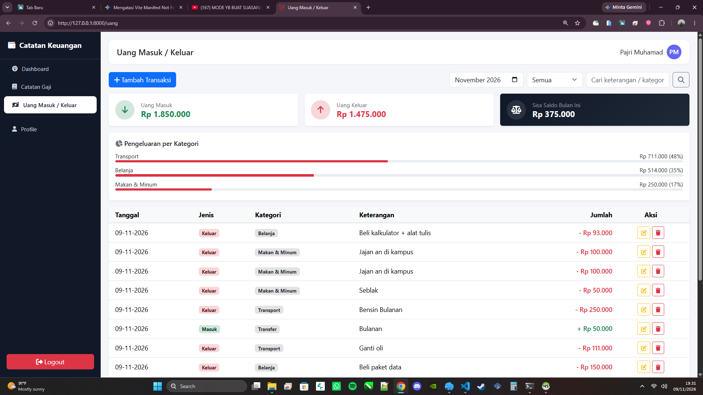
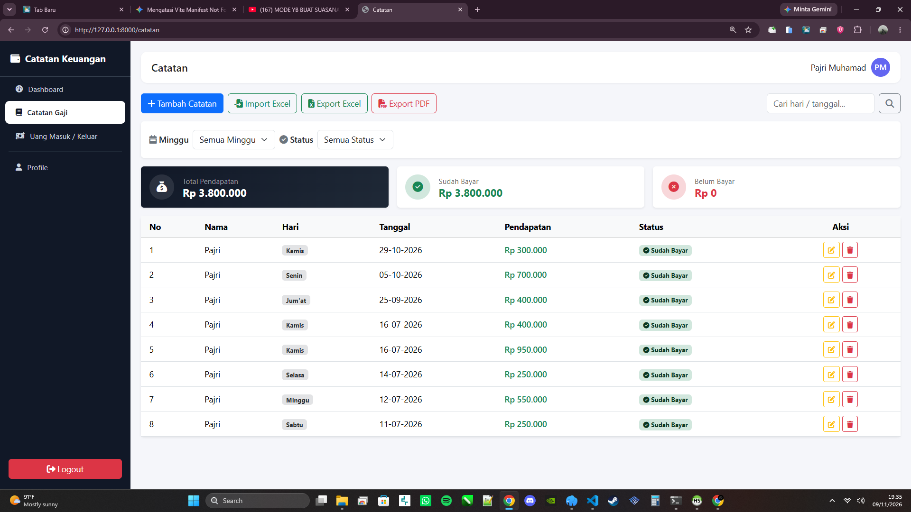
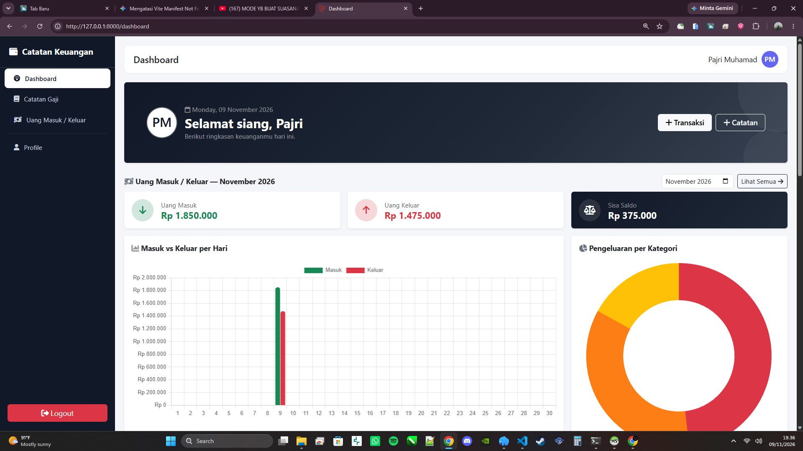

# SI Catatan Keuangan & Gaji

Aplikasi berbasis web untuk mengelola dan memantau pencatatan keuangan pribadi/perusahaan, mencakup arus kas masuk & keluar, rekapitulasi gaji, serta ringkasan data visual melalui dashboard intuitif.

---

## 📷 Tangkapan Layar (Screenshots)

### 1. Transaksi Keuangan (Masuk & Keluar)


### 2. Catatan Gaji


### 3. Dashboard


---

## 🚀 Fitur Utama

- **Dashboard**: Menampilkan ringkasan total pemasukan, pengeluaran, dan visualisasi data.
- **Catatan Keuangan (Keluar & Masuk)**: Transaksi pencatatan arus kas dengan detail tanggal, kategori, dan jumlah.
- **Catatan Gaji**: Pengelolaan data penggajian dan riwayat pembayaran gaji.
- **Profil**: Pengaturan data akun pengguna.

---

## 🛠️ Persyaratan Sistem

- **PHP**: `^8.2` atau `^8.3`
- **Laravel**: `^11.0` atau `^12.0`
- **Composer**
- **Node.js & NPM**
- **MySQL / MariaDB**

---

## ⚙️ Cara Instalasi & Penggunaan

1. **Clone Repositori**
   ```bash
   git clone [https://github.com/username/SI_Catatan_Keuangan.git](https://github.com/username/SI_Catatan_Keuangan.git)
   cd SI_Catatan_Keuangan